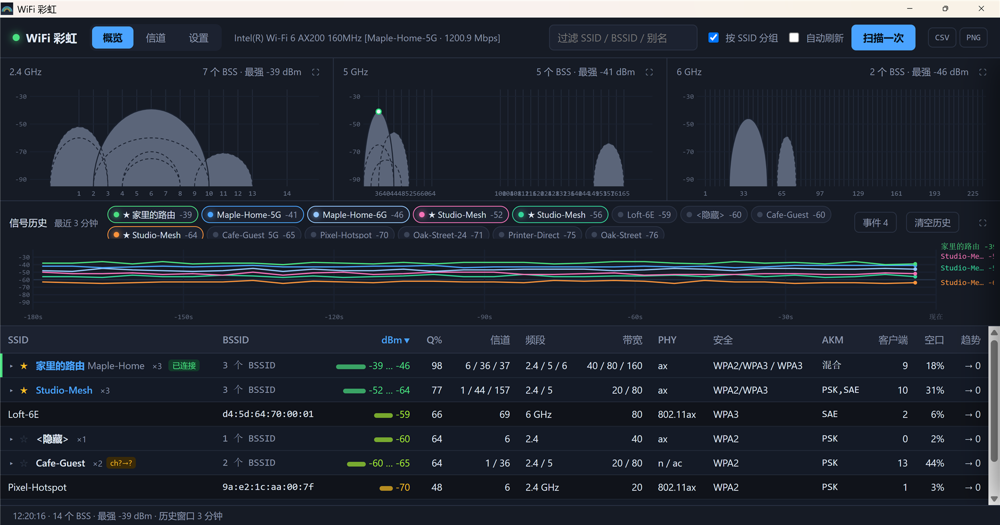

# WiFi 彩虹 · WiFi Rainbow

[English](../README.md) · [使用手册](manual.zh-CN.md) · [User manual](manual.en.md) · [代码签名策略](CODE_SIGNING_POLICY.md)

Windows 上的 Wi-Fi 分析小工具：实时扫描附近的接入点，画出三频段信号图、信道占用和干扰关系，帮你挑一个干净的信道、看清楚自己连的是哪个 AP、用的是什么安全方式。

Rust + Tauri 2 + 原生 HTML/JS，除了 Windows 自带的 WebView2 没有任何第三方运行时。不联网，不收集任何数据。



## 下载

安装包在 [Releases](https://github.com/yunnysunny/wifi-rainbow/releases) 页面：`WiFi-Rainbow_<版本>_x64-setup.exe`，按用户安装到 `%LOCALAPPDATA%\WiFi Rainbow\`，不需要管理员权限。

代码签名：项目已向 [SignPath Foundation](https://signpath.org/) 申请面向开源软件的免费签名。在申请批准之前，发布的安装包**没有签名**，首次运行会弹 SmartScreen 提示。细节与当前状态见 [代码签名策略](CODE_SIGNING_POLICY.md)。

系统要求：Windows 10 / 11 x64，带无线网卡，已安装 [WebView2 运行时](https://developer.microsoft.com/microsoft-edge/webview2/)（Windows 11 自带）。

## 功能

**概览**
- 2.4 / 5 / 6 GHz 三频段弧形信号图：弧宽 = 信道带宽，高度 = 信号强度；被更强 AP 完全盖住的弧改虚线
- 3 分钟信号历史曲线，或切到「事件」看最近的变化：新出现 / 消失 / 掉信号 / 换信道 / 换带宽
- AP 列表：SSID、BSSID、dBm、质量、信道、频段、带宽、PHY、安全方式、AKM、客户端数、空口占用、趋势；可排序，可按 SSID / BSSID / 别名过滤
- 按路由分组：`Home` / `Home-5G` 这类同一台路由的多个 BSSID 折成一行，点开看成员
- 已连接的 AP 单独标记，并显示实际协商的认证 / 加密 / 速率
- 给 SSID 起别名、加入关注列表（历史曲线默认画它们）
- 导出当前列表为 CSV；PNG 可只导出图表或整窗口截图

**信道**
- 三频段频谱占用图
- 同频 / 邻频重叠分析、载干比（CIR）、主要干扰源
- 每频段的候选信道评分与建议信道（5 GHz 避开 DFS）
- 鼠标悬停某个信道：该信道上的 AP 变蓝，频谱重叠会干扰它的变琥珀，其余压暗

**AP 详情抽屉**
- 信号 / 质量 / 估算距离 / 厂商、最近 3 分钟 sparkline、干扰画像
- 射频全字段：频段、信道、频率、带宽、PHY、IE 长度、安全、AKM、Cipher、客户端、信道利用率

**设置**
- 隐藏 SSID 开关、最低信号阈值、频段开关、自动刷新间隔、扫描网卡（多卡时选一块）
- 中 / 英双语，即时切换

每个视图的截图见 [使用手册](manual.zh-CN.md)。

## 数据来源

全部来自 Windows 自带的 `wlanapi.dll`（`WlanScan` → `WlanGetNetworkBssList`，当前连接用 `WlanQueryInterface`），用 Rust 直接 FFI，不依赖任何 crate。信道带宽、安全方式、BSS Load 等字段 API 不直接给，是从 Beacon 的 Information Element 里解析出来的（HT / VHT / HE / RSN / WPA）。

Windows 没有 monitor 模式，所以这是轮询式扫描（最快约 2 秒一轮），看不到瞬时突发。干扰模型只按功率重叠折算，不建 CSMA 竞争模型；估算距离是简化的对数路径损耗公式，只能当相对参考。

只在 Intel AX200 上实测过。IE 池的内存布局是逆向出来的（驱动返回的 `ulIeOffset` 不可信），换别的网卡厂商建议先跑 `WLAN_IE_DUMP=1 cargo run -p wlan-core --bin wlanscan` 对照一下。

## 从源码构建

需要 Rust stable（1.80+）与 [Tauri 2 的 Windows 前置条件](https://tauri.app/start/prerequisites/)（Visual Studio C++ 生成工具、WebView2）。

```powershell
cd rust
cargo build                      # 调试版：target/debug/wifi-rainbow.exe
cargo install tauri-cli --version "^2" --locked
cargo tauri build                # 安装包：target/release/bundle/nsis/WiFi-Rainbow_*_x64-setup.exe
```

前端在 `rust/ui/`，构建时嵌进 exe，改完前端要重新 `cargo build`。

命令行探针（和界面同一套解析）：

```powershell
cargo run -p wlan-core --bin wlanscan
```

## 测试

- `npm test`（或 `node tests/changes.test.js`）：变更追踪模块的单元测试，CI 里跑。
- `cargo clippy --workspace --all-targets -- -D warnings`，CI 里跑。
- 界面烟雾测试：往 `%LOCALAPPDATA%\WiFiRainbow\selftest` 写一个视图名（`inspector` / `channels` / `detail` / `settings` / `group` / `events` / `conn` / `export` / `en` …）再启动，程序会对真机网卡跑十几类探针，结果写在 `%LOCALAPPDATA%\WiFiRainbow\ui.log`，然后停在对应视图。需要真机网卡，不进 CI。验完记得删掉标记文件。
- 演示模式：同一个文件里写 `demo:<视图>`（或 `demo:en-<视图>`），程序用一组合成网络代替真机扫描；手册里的截图就是这么来的。

更多细节、已知边界与待办见 [TODO.md](../TODO.md)。

## 文档站

`tools/build-docs.mjs` 把 `docs/` 转成一个带产品首页和统一导航菜单（首页 · 使用手册 · 代码签名 · 下载 · GitHub · 语言切换）的静态站点：

```powershell
npm install
npm run docs         # -> site/
```

| 页面 | 路径 |
|---|---|
| 首页（英文） | `site/index.html` |
| 首页（中文） | `site/zh-CN/index.html` |
| 手册（英文） | `site/manual/index.html` |
| 手册（中文） | `site/zh-CN/manual/index.html` |
| 代码签名策略 | `site/code-signing.html` |

面向 Cloudflare Pages：连上仓库，构建命令填 `npm ci && npm run docs`，输出目录填 `site`，不需要别的配置；页面不引用任何外部资源。

## 隐私

程序不联网，不向任何系统传输信息。设置、别名、关注列表存在本机 WebView2 的用户数据里；界面日志写在 `%LOCALAPPDATA%\WiFiRainbow\ui.log`；导出的 CSV / PNG 由你自己决定去向。

## 许可证

[MIT](../LICENSE)
