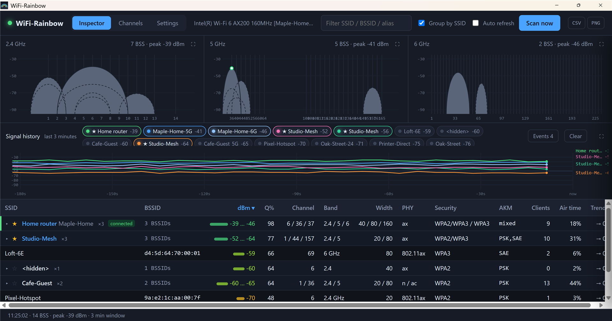
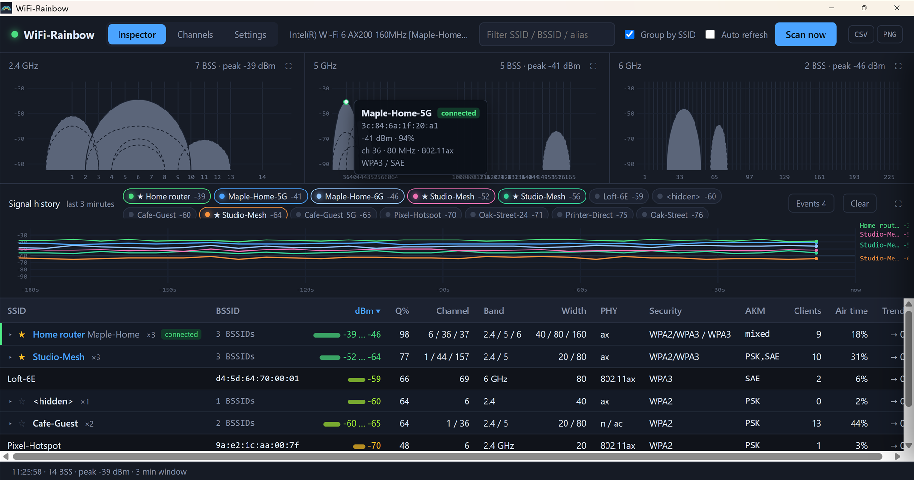
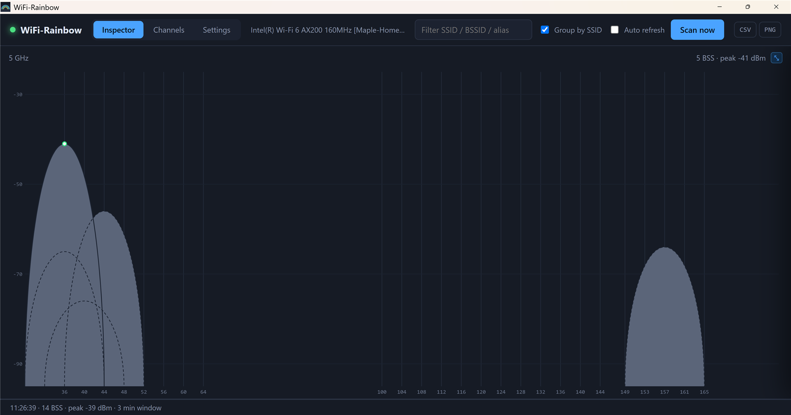
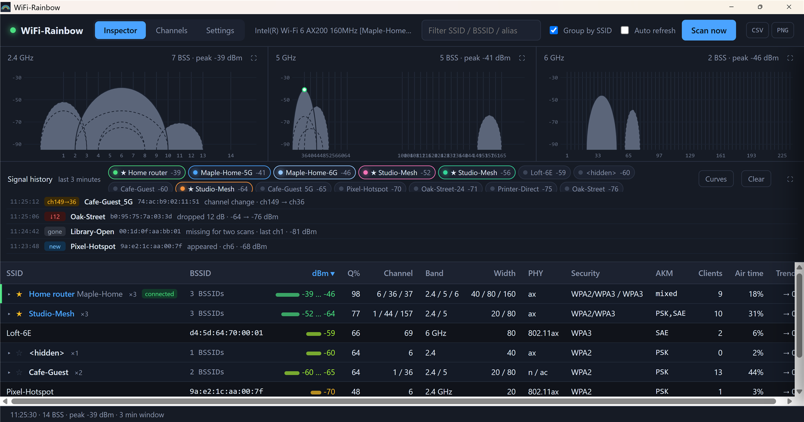
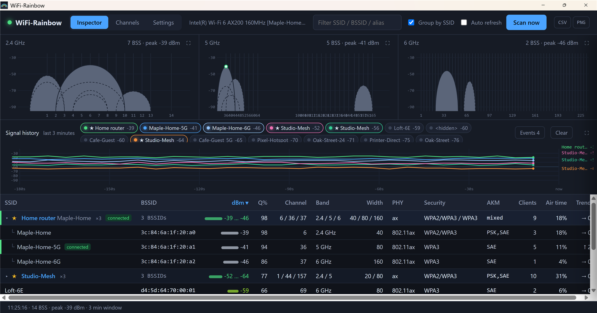
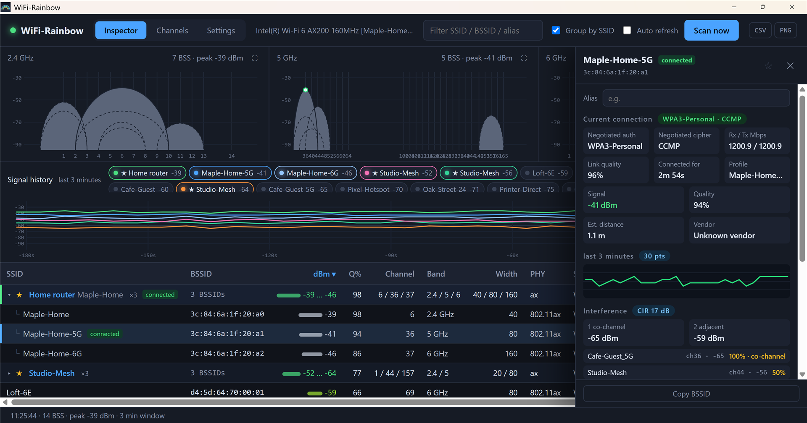
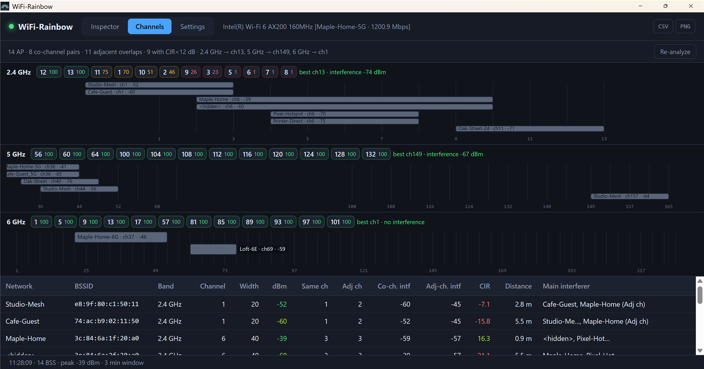
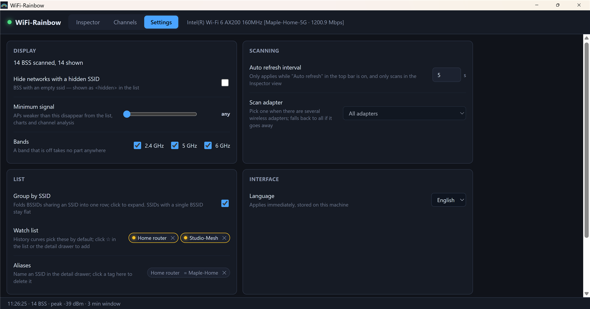

# WiFi-Rainbow User Manual

[中文版](manual.zh-CN.md) · [Project README](../README.md) · [Code signing policy](CODE_SIGNING_POLICY.md)

WiFi-Rainbow is a Wi-Fi analyzer for Windows. It scans the access points around you and shows, in one window, where they sit on the spectrum, how strong they are, how they interfere with each other, which channel is the quietest, and what your own adapter is actually connected to.

The screenshots in this manual were taken in the built-in demo mode with a synthetic set of networks, so the names you see are not real neighbours.

## 1. Install and first run

1. Download `WiFi-Rainbow_<version>_x64-setup.exe` from the [Releases](https://github.com/yunnysunny/wifi-rainbow/releases) page.
2. Run it. The program installs for the current user only, into `%LOCALAPPDATA%\WiFi-Rainbow\`, and does not ask for administrator rights. It adds a Start menu entry and a desktop shortcut.
3. Start **WiFi-Rainbow**. The first scan runs automatically and the window fills up after about two seconds.

Requirements: Windows 10 or 11 (x64), a wireless adapter, and the Microsoft Edge WebView2 runtime (preinstalled on Windows 11; on Windows 10 [download it here](https://developer.microsoft.com/microsoft-edge/webview2/) if the program does not start).

> **SmartScreen warning.** Release builds are signed through SignPath (see the [code signing policy](CODE_SIGNING_POLICY.md)). An unsigned development build, or a very new release that has not built up reputation yet, may trigger "Windows protected your PC". Click *More info* → *Run anyway*.

To uninstall, use *Settings → Apps → Installed apps*, or run `uninstall.exe` from the install directory. Your settings (aliases, watch list, filters) live in the WebView2 profile and survive a reinstall.

## 2. The window at a glance

| Area | What it is |
|---|---|
| Tabs | **Inspector** (live scan), **Channels** (interference and channel recommendation), **Settings** |
| Adapter | The wireless adapter in use. When connected it also shows the network name and the negotiated link speed. |
| Filter | Narrows the AP table by SSID, BSSID or alias. Case-insensitive, matches anywhere. |
| Group by SSID | Folds the BSSIDs of one router into a single row (see [3.3](#33-ap-table)). |
| Auto refresh | Rescans at the interval set in Settings (default 5 s) while the Inspector tab is visible. |
| Scan now | One scan right away, also while auto refresh is off. |
| CSV / PNG | Export the current table or the current view (see [6](#6-export)). |
| Status bar | Time of the last scan, number of BSS found, strongest signal. Turns red when a scan fails; click it to see the error. |

## 3. Inspector

### 3.1 Band charts

The top row shows one chart per band: 2.4 GHz, 5 GHz and 6 GHz. Every access point is drawn as a half-ellipse:

- **Horizontal position** is the centre frequency; **width** is the channel width (20 / 40 / 80 / 160 MHz).
- **Height** is signal strength in dBm (−95 at the bottom, −25 at the top). Colour follows the same scale as the table: green is strong, yellow is fair, red is weak.
- An arc that sits entirely inside a stronger one on the same channel is drawn **dashed**, so it is still visible.
- A white dot on top of an arc marks the AP you are **connected to**.

Hover an arc to see its details; click it to open the [details drawer](#4-ap-details-drawer). Where arcs overlap, the strongest AP under the pointer wins.

The ⛶ button in a chart header enlarges that chart to the whole view; press <kbd>Esc</kbd> or click ⤡ to go back.

### 3.2 Signal history and events

The middle panel keeps three minutes of signal history, one curve per BSSID.

- The **legend chips** list the networks currently seen, strongest first. Click a chip to add or remove its curve. Up to six curves are picked automatically (watched networks first, then the strongest); once you click a chip the selection is yours until you press *Clear*.
- A **★** in a chip means the network is on your watch list.
- **Clear** empties the history and the event log.

The **Events** button switches the panel to a list of changes between scans:

| Event | Reported when |
|---|---|
| new | A BSSID is seen for the first time (after the first two warm-up scans). |
| gone | A BSSID has been missing for two consecutive scans. |
| ↓ *n* | The signal is at least 7 dB below the average of the last three samples, **for two scans in a row**. At most one per BSSID per minute. |
| ch *a*→*b* | The channel changed. |
| *a*→*b* M | The channel width changed. |

The two-scan confirmation and the cooldown exist because Windows adapters routinely report the same AP 10–17 dB apart on consecutive scans. A single low reading is noise, not a drop.

Click an event to open the AP's details. The same events also appear as small badges next to the SSID in the table for 25 seconds.

### 3.3 AP table

| Column | Meaning |
|---|---|
| SSID | Network name; `<hidden>` for networks that do not broadcast one. Badges: **connected**, **new**, **gone**, ↓*n*, ch*a*→*b*, *a*→*b*M. |
| BSSID | MAC address of the access point radio. |
| dBm | Received signal strength, with a bar. |
| Q% | Link quality as reported by the driver (0–99). |
| Channel / Band / Width | Where the AP transmits. |
| PHY | Wi-Fi generation: 802.11n = Wi-Fi 4, ac = 5, ax = 6/6E, be = 7. |
| Security | OPEN, WEP, WPA, WPA2, WPA2/WPA3 (transition mode), WPA3, WPA3-ENT, OWE. |
| AKM | Authentication suites advertised: PSK, SAE, 802.1X, FT-… |
| Clients | Stations associated to the AP (only if the AP sends BSS Load). |
| Air time | Channel utilization reported by the AP (BSS Load). |
| Trend | Change of the signal over the last few scans. |

Click a header to sort; click again to flip the direction. Sort key, direction, filter text and expanded groups are remembered between runs.

**Group by SSID** folds the radios of one router into a single row:

Two BSSIDs are put in the same group when their SSIDs are equal after stripping a band suffix (`Home` / `Home-5G` / `Home_5G` / `Home 2.4GHz`), **or** when the first five bytes of their BSSIDs are equal. The group row shows the number of radios, the channels (`6 / 36 / 37`), the strongest … weakest signal, the bands, widths and security modes in use, the total number of clients and the highest air-time value. Click the row to expand it. Hidden networks form their own group; an SSID with a single radio stays a plain row.

The ☆ in front of a row adds the SSID to the **watch list**. Watched networks get their history curves drawn by default, every time the program starts.

Click any plain or member row to open the details drawer.

## 4. AP details drawer

From top to bottom:

- **Alias** – a name of your own for this SSID ("Home router", "Office"). It replaces the SSID in the table, legend, tooltips and exports; the real SSID is still shown next to it. Press <kbd>Enter</kbd> to save, <kbd>Esc</kbd> to cancel, empty it to remove. Aliases are stored on this machine only.
- **☆ / ★** – toggle the watch list.
- **Current connection** (only for the AP your adapter is connected to) – the authentication and cipher actually negotiated (`WPA3-Personal · CCMP`, as opposed to what the AP *advertises*), receive / transmit link rate, link quality, how long the program has seen you connected, and the Windows profile name.
- **Signal / Quality / Est. distance / Vendor** – distance is a rough log-distance estimate (−40 dBm at 1 m, path-loss exponent 2.7); use it for comparison, not measurement. Vendor comes from a small built-in OUI table.
- **Last 3 minutes** – sparkline of this BSSID.
- **Interference** – carrier-to-interference ratio (CIR) of this AP against every other AP that overlaps it on the same band, split into co-channel (≥ 80 % overlap) and adjacent-channel, plus the strongest interferers with their overlap percentage. CIR ≥ 25 dB is comfortable, 12–25 dB is fine, below 12 dB expect slowdowns.
- **Radio** – band, channel, centre frequency, width, PHY, length of the beacon's information elements, security, AKM, cipher, client count.
- **Air time** – channel utilization reported by the AP.
- **Copy BSSID**.

The drawer follows the scans: values update after every refresh, and it closes if the AP disappears.

## 5. Channels view

For each band:

- **Score chips** – candidate channels ranked by how much interference power lands on them (100 = nothing seen). Hover a chip for the number of APs and the interference level. On 5 GHz the recommendation avoids DFS channels unless nothing else is left.
- **Recommendation** – the best channel and the interference level you would see there.
- **Spectrum** – one bar per AP (up to the eight strongest; the rest are in the table), bar width = channel width, colour = signal strength.

The table lists every AP with its co-channel and adjacent-channel neighbours, the interference power from each kind, the CIR, the estimated distance and the main interferers. Click a row to open the details drawer. *Re-analyze* recomputes from the last scan without rescanning.

The model sums overlapping power only; it does not simulate CSMA contention. Treat the numbers as a ranking, not a prediction of throughput.

## 6. Export

- **CSV** – the table as currently filtered and sorted (ungrouped), with the same columns as on screen plus alias, connected flag, vendor, frequency, cipher and scan time. UTF-8 with BOM, so Excel opens it correctly.
- **PNG** – the current view as one image: in Inspector the three band charts and the history panel; in Channels the three spectra.

Files are written to your *Downloads* folder; the status bar shows the full path.

## 7. Settings

| Setting | Effect |
|---|---|
| Hide networks with a hidden SSID | Removes `<hidden>` BSS from every view. |
| Minimum signal | APs weaker than this are removed from every view and from the channel analysis. |
| Bands | A band that is off takes no part anywhere. |
| Auto refresh interval | 1–60 s. A scan itself takes about two seconds, so very short intervals do not scan faster. |
| Scan adapter | With several wireless adapters, pick the one to scan with. If it goes away, scanning falls back to all adapters. |
| Group by SSID | Same as the toggle in the top bar. |
| Watch list / Aliases | Review and remove entries. |
| Language | Chinese or English; applies immediately, including the window title. |
| Reset to defaults | Resets the switches above. Aliases and the watch list are kept. |

## 8. Tips and FAQ

**The signal jumps around by 10 dB or more between scans.** That is the adapter, not the AP: Windows mixes measurements from beacons, probe responses and cached results. The history curve and the trend column average this out; the event detector requires two consecutive low readings.

**A network keeps flickering between present and gone.** Scans sometimes return a partial list while the driver is still collecting. The program ignores a scan that is 40 % shorter than the previous one when deciding what has disappeared, and needs two consecutive misses before reporting *gone*.

**Nothing on 6 GHz.** Either there is no 6E network nearby, or your adapter is not 6E-capable. The 6 GHz chart only draws what the driver reports.

**"No wireless adapter found".** Wi-Fi is switched off, the adapter is disabled, or the WLAN AutoConfig service is stopped. The status bar turns red; click it for the exact error. Auto refresh retries with exponential back-off (2, 4, 8 … 60 s); *Scan now* retries immediately.

**Can it capture packets or see client traffic?** No. Windows has no monitor mode for ordinary adapters; everything here comes from the Native Wifi scan API, i.e. beacons and probe responses.

**Where is my data?** Settings, aliases and the watch list are in the WebView2 profile of the app; the UI log is at `%LOCALAPPDATA%\WiFiRainbow\ui.log` (rotated at 1 MiB). Nothing leaves your machine.

**Demo mode / smoke test.** Write `demo:inspector` (or `demo:channels`, `demo:en-detail`, …) into the file `%LOCALAPPDATA%\WiFiRainbow\selftest` and start the program: it shows a synthetic set of networks instead of scanning. Writing `inspector`, `channels`, `settings`, … runs the built-in smoke test against the real adapter and logs the results to `ui.log`. Delete the file afterwards.

## 9. Privacy

WiFi-Rainbow makes no network connections and transfers no information to any system. All data shown comes from the local Windows Native Wifi API. Exports go only where you put them.
