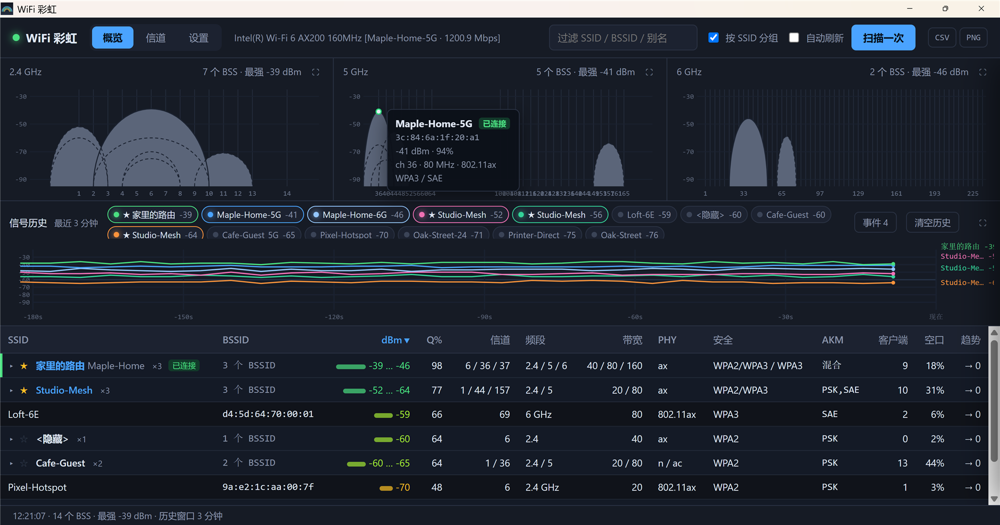
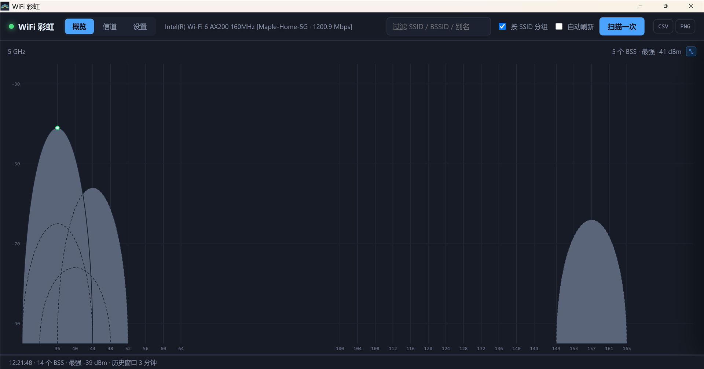
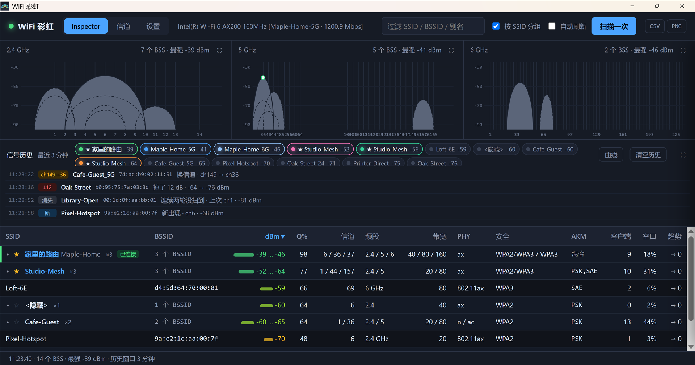
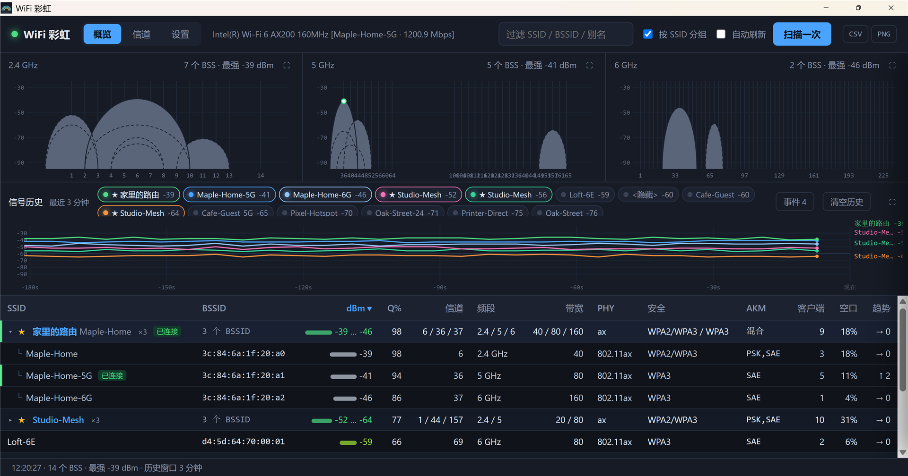
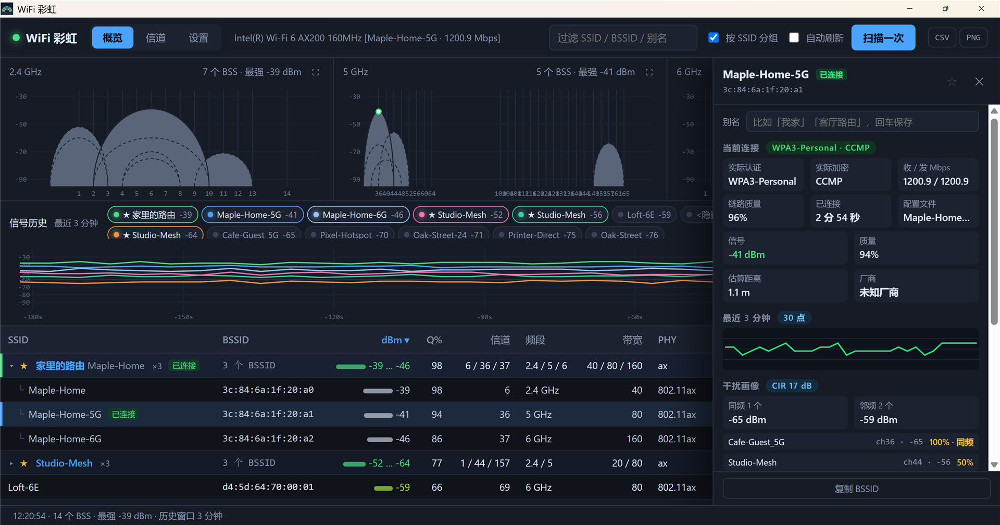
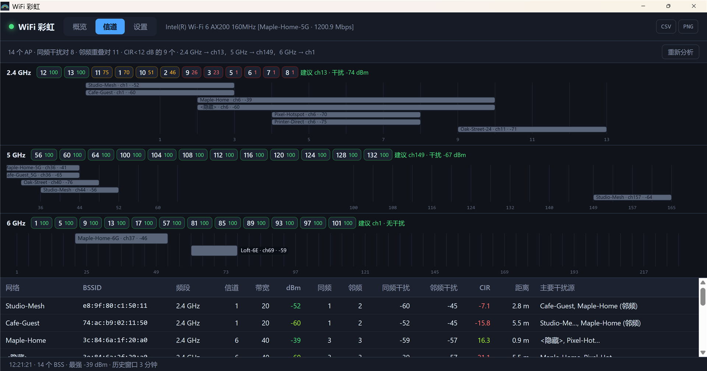
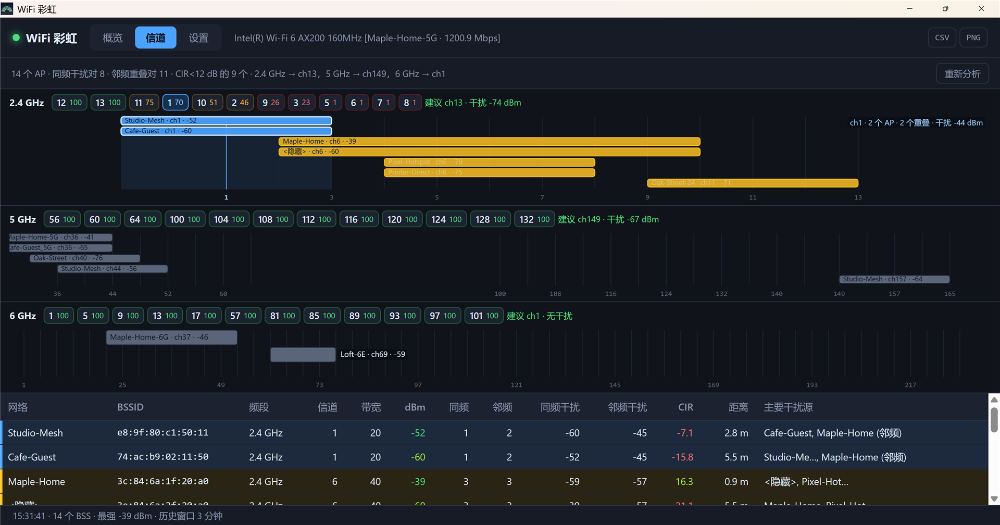
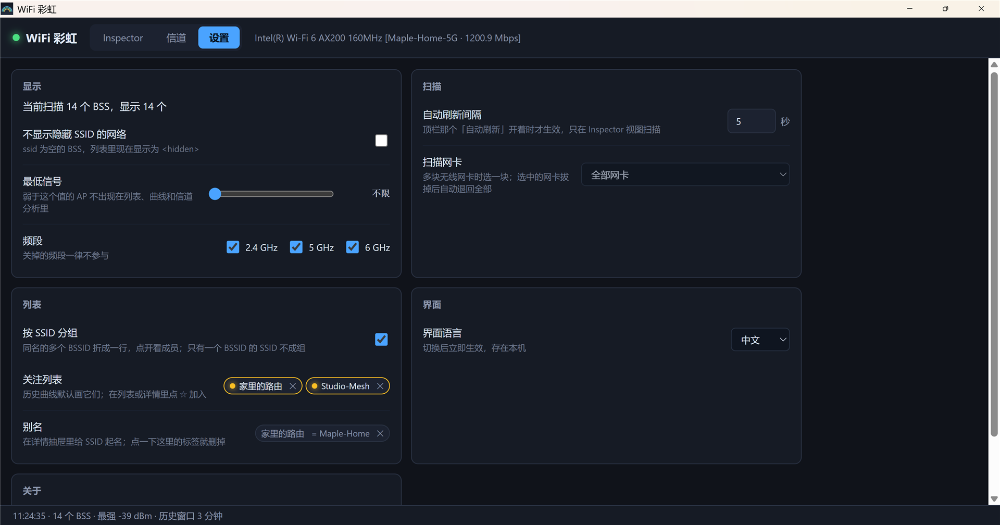

# WiFi 彩虹（WiFi Rainbow）使用手册

[English](manual.en.md) · [项目说明（中文）](README.zh-CN.md) · [代码签名策略](CODE_SIGNING_POLICY.md)

WiFi 彩虹是一个 Windows 上的 Wi-Fi 分析工具。它扫描周围的接入点，在一个窗口里告诉你：它们在频谱上的位置和强弱、彼此怎么干扰、哪个信道最干净、你自己的网卡连的是哪个 AP、实际用的是什么加密方式。

本手册的截图都是在内置的演示模式下用一组合成的网络数据截的，里面的名字不是真实邻居。

## 1. 安装与首次运行

1. 从 [Releases](https://github.com/yunnysunny/wifi-rainbow/releases) 页面下载 `WiFi-Rainbow_<版本>_x64-setup.exe`。
2. 运行它。程序只给当前用户安装，位置在 `%LOCALAPPDATA%\WiFi Rainbow\`，不要管理员权限；会建开始菜单项和桌面快捷方式。
3. 启动 **WiFi Rainbow**。第一次扫描自动进行，两秒左右窗口就有内容了。

系统要求：Windows 10 / 11（x64）、一块无线网卡、Microsoft Edge WebView2 运行时（Windows 11 自带；Windows 10 上程序起不来的话到 [这里下载](https://developer.microsoft.com/microsoft-edge/webview2/)）。

> **SmartScreen 提示。** 目前的发布版本**没有代码签名**：项目已向 SignPath Foundation 申请面向开源软件的免费签名，正在等待批准（见 [代码签名策略](CODE_SIGNING_POLICY.md)）。在此之前，首次运行可能会弹「Windows 已保护你的电脑」，点「更多信息」→「仍要运行」即可。签名启用之后，刚发布、还没积累信誉的新版本也可能弹同样的提示。

卸载：「设置 → 应用 → 安装的应用」，或运行安装目录里的 `uninstall.exe`。你的设置（别名、关注列表、过滤条件）存在 WebView2 的用户数据里，重装后还在。

## 2. 窗口概览

| 区域 | 说明 |
|---|---|
| 标签页 | **概览**（实时扫描）、**信道**（干扰分析与信道建议）、**设置** |
| 网卡 | 当前使用的无线网卡。已连接时还显示网络名和协商出来的链路速率。 |
| 过滤 | 按 SSID、BSSID 或别名筛表格，不分大小写，任意位置匹配。 |
| 按 SSID 分组 | 把同一台路由的几个 BSSID 折成一行（见 [3.3](#33-ap-表格)）。 |
| 自动刷新 | 停在「概览」页时按设置里的间隔（默认 5 秒）反复扫描。 |
| 扫描一次 | 立刻扫一次，自动刷新关着也能用。 |
| CSV / PNG | 导出当前表格或当前视图（见 [6](#6-导出)）。 |
| 状态栏 | 上次扫描时间、扫到的 BSS 数、最强信号。扫描失败时变红，点一下看错误详情。 |

## 3. 概览

### 3.1 三频段图

最上面一行是三张图：2.4 GHz、5 GHz、6 GHz。每个接入点画成一个半椭圆：

- **横向位置**是中心频率，**宽度**是信道带宽（20 / 40 / 80 / 160 MHz）。
- **高度**是信号强度 dBm（底部 −95，顶部 −25）。颜色和表格一致：绿强、黄一般、红弱。
- 同信道上被更强的弧完全套住的，画成**虚线**，不然根本看不见。
- 弧顶的白点标记你**当前连接**的 AP。

鼠标悬停看详情，点击打开 [详情抽屉](#4-ap-详情抽屉)。多个弧叠在一起时，取指针下最强的那个。

图标题右侧的 ⛶ 把那张图铺满整个视图；按 <kbd>Esc</kbd> 或点 ⤡ 还原。

### 3.2 信号历史与事件

中间一栏保留最近 3 分钟的信号历史，每个 BSSID 一条曲线。

- **图例标签**列出当前看到的网络，最强在前。点一下增减它的曲线。默认自动挑最多 6 条（关注的网络优先，再按最强补齐）；你点过标签后选择就归你管，直到按「清空历史」。
- 标签里的 **★** 表示这个网络在关注列表里。
- **清空历史**同时清空事件记录。

「**事件**」按钮把这一栏切成两次扫描之间的变化列表：

| 事件 | 触发条件 |
|---|---|
| 新 | 第一次看见这个 BSSID（启动后前两轮预热不算）。 |
| 消失 | 连续两轮没扫到。 |
| ↓ *n* | 比最近三次采样的均值低 7 dB 以上，**并且连续两轮都低**。同一 BSSID 一分钟最多报一次。 |
| ch *a*→*b* | 换了信道。 |
| *a*→*b* M | 换了带宽。 |

要连续两轮确认、还要冷却，是因为 Windows 的网卡在相邻两轮里把同一个 AP 报成相差 10～17 dB 是常事。单次读数低不是掉信号，是噪声。

点一条事件打开对应 AP 的详情。这些事件也会以小标签的形式挂在表格 SSID 旁边 25 秒。

### 3.3 AP 表格

| 列 | 含义 |
|---|---|
| SSID | 网络名；不广播名字的显示 `<隐藏>`。标签：**已连接**、**新**、**消失**、↓*n*、ch*a*→*b*、*a*→*b*M。 |
| BSSID | 接入点射频的 MAC 地址。 |
| dBm | 接收信号强度，带一条色柱。 |
| Q% | 驱动报告的链路质量（0～99）。 |
| 信道 / 频段 / 带宽 | AP 在哪发。 |
| PHY | Wi-Fi 代际：802.11n = Wi-Fi 4，ac = 5，ax = 6/6E，be = 7。 |
| 安全 | OPEN、WEP、WPA、WPA2、WPA2/WPA3（过渡模式）、WPA3、WPA3-ENT、OWE。 |
| AKM | 宣告的认证套件：PSK、SAE、802.1X、FT-… |
| 客户端 | 关联到这个 AP 的终端数（AP 发 BSS Load 才有）。 |
| 空口 | AP 报告的信道利用率（BSS Load）。 |
| 趋势 | 最近几轮信号的变化。 |

点表头排序，再点一下反向。排序键、方向、过滤词、展开的组都会记住，下次启动沿用。

**按 SSID 分组**把一台路由的几个射频折成一行：

两个 BSSID 归同一组的条件：去掉频段后缀后 SSID 相同（`Home` / `Home-5G` / `Home_5G` / `Home 2.4GHz`），**或者** BSSID 前五个字节相同。组行显示射频个数、信道（`6 / 36 / 37`）、最强…最弱信号、用到的频段 / 带宽 / 安全方式、客户端合计、最高空口占用。点组行展开。隐藏网络自成一组；只有一个射频的 SSID 保持平铺行。

行首的 ☆ 把这个 SSID 加进**关注列表**。关注的网络每次启动都默认画历史曲线。

点平铺行或组成员行打开详情抽屉。

## 4. AP 详情抽屉

从上到下：

- **别名**：给这个 SSID 起个自己的名字（「家里的路由」「公司」）。表格、图例、浮层、导出里都用别名显示，真实 SSID 跟在旁边。<kbd>Enter</kbd> 保存，<kbd>Esc</kbd> 取消，清空即删除。别名只存在本机。
- **☆ / ★**：切换关注。
- **当前连接**（只有你网卡连着的那个 AP 才有）：实际协商出来的认证方式和加密（`WPA3-Personal · CCMP`，区别于 AP *宣告*支持什么）、收 / 发链路速率、链路质量、程序观察到的已连接时长、Windows 配置文件名。
- **信号 / 质量 / 估算距离 / 厂商**：距离是粗略的对数距离估算（1 m 处 −40 dBm，路径损耗指数 2.7），只能比相对远近，不是测量值。厂商来自内置的一张小 OUI 表。
- **最近 3 分钟**：这个 BSSID 的 sparkline。
- **干扰画像**：这个 AP 相对同频段上所有与它重叠的 AP 的载干比（CIR），分同频（重叠 ≥ 80%）和邻频两类，并列出最强的几个干扰源及重叠比例。CIR ≥ 25 dB 很舒服，12～25 dB 还行，低于 12 dB 会明显变慢。
- **射频**：频段、信道、中心频率、带宽、PHY、Beacon 的 IE 长度、安全、AKM、Cipher、客户端数。
- **空口占用**：AP 报告的信道利用率。
- **复制 BSSID**。

抽屉跟着扫描走：每次刷新后数值更新；AP 消失了抽屉就关掉。

## 5. 信道视图

每个频段：

- **评分标签**：候选信道按落在上面的干扰功率排序（100 = 什么都没扫到）。悬停看 AP 数和干扰强度。5 GHz 的建议会避开 DFS 信道，除非没别的可选。
- **建议**：最佳信道和你在那里会看到的干扰强度。
- **频谱**：每个 AP 一条（最多画最强的 8 个，其余在表里），条宽 = 带宽，颜色 = 信号强度。

表格列出每个 AP 的同频 / 邻频邻居、两类干扰功率、CIR、估算距离和主要干扰源。点一行打开详情抽屉。「重新分析」用上次扫描的数据重算，不重新扫。

**看某个信道上都有谁**：把鼠标悬在某个信道的评分标签上，或者悬在频谱图里那个信道号的位置，横条会按它和这个信道的关系换色：

- **蓝色**：主信道就是这个信道的 AP。
- **琥珀色**：主信道不是它，但频谱和它重叠、会干扰这个信道的 AP。2.4 GHz 信道只隔 5 MHz，一个 20 MHz 的 AP 实际压着左右各 4 个信道，所以悬停 ch3 时 ch1 上的 AP 都会变琥珀。
- **压暗**：和这个信道无关的 AP，保留原来的信号色但变淡。

频谱底下画出一条浅蓝色竖带标出信道范围，右上角写着这个信道上有几个 AP、几个重叠、干扰多强；下面表格里对应的行也用同样两种颜色标出。鼠标移开即恢复。

模型只把重叠功率加起来，不模拟 CSMA 竞争。把这些数字当排名用，别当吞吐量预测。

## 6. 导出

- **CSV**：当前过滤、排序后的表格（不分组），列与界面一致，另加别名、是否已连接、厂商、频率、Cipher、扫描时间。UTF-8 带 BOM，Excel 直接打开不乱码。
- **PNG**：当前视图拼成一张图：概览页是三张频段图 + 历史栏；信道页是三张频谱。

文件写到你的「下载」文件夹，状态栏显示完整路径。

## 7. 设置

| 设置项 | 作用 |
|---|---|
| 不显示隐藏 SSID 的网络 | 所有视图里去掉 `<隐藏>` 的 BSS。 |
| 最低信号 | 弱于这个值的 AP 从所有视图和信道分析里去掉。 |
| 频段 | 关掉的频段一律不参与。 |
| 自动刷新间隔 | 1～60 秒。扫描本身约两秒，间隔再短也快不了。 |
| 扫描网卡 | 多块无线网卡时选一块；它拔掉了就退回全部网卡。 |
| 按 SSID 分组 | 和顶栏那个开关是同一个。 |
| 关注列表 / 别名 | 查看和删除。 |
| 界面语言 | 中 / 英，立即生效，窗口标题也跟着变。 |
| 恢复默认设置 | 重置上面的开关。别名和关注列表保留。 |

## 8. 技巧与常见问题

**信号在两次扫描之间跳 10 dB 以上。** 这是网卡的事，不是 AP：Windows 把 Beacon、Probe Response 和缓存的测量混在一起报。历史曲线和趋势列会平均掉它；事件检测要连续两轮都低才报。

**某个网络一会儿在一会儿不在。** 驱动还在收集时，扫描有时返回半截列表。程序在判断「谁消失了」时会忽略比上一轮短 40% 以上的列表，并且连续两轮没扫到才报「消失」。

**6 GHz 什么都没有。** 要么附近没有 6E 网络，要么你的网卡不支持 6E。6 GHz 图只画驱动报上来的东西。

**「没有可用无线网卡」。** Wi-Fi 关了、网卡被禁用，或者 WLAN AutoConfig 服务停了。状态栏变红，点一下看具体错误。自动刷新按指数退避重试（2、4、8…60 秒），「扫描一次」立即重试。

**能抓包、能看客户端流量吗？** 不能。普通网卡在 Windows 上没有 monitor 模式，这里所有数据都来自 Native Wifi 的扫描 API，也就是 Beacon 和 Probe Response。

**我的数据在哪？** 设置、别名、关注列表在程序的 WebView2 用户数据里；界面日志在 `%LOCALAPPDATA%\WiFiRainbow\ui.log`（1 MiB 轮转）。没有任何东西离开你的电脑。

**演示模式 / 烟雾测试。** 往 `%LOCALAPPDATA%\WiFiRainbow\selftest` 文件里写 `demo:inspector`（或 `demo:channels`、`demo:en-detail` …）再启动，程序会用一组合成网络代替真机扫描。写 `inspector`、`channels`、`settings` … 则对真机网卡跑内置烟雾测试，结果记在 `ui.log`。用完删掉这个文件。

## 9. 隐私

WiFi 彩虹不联网，不向任何系统传输信息。显示的数据全部来自本机的 Windows Native Wifi API。导出的文件只去你放的地方。
